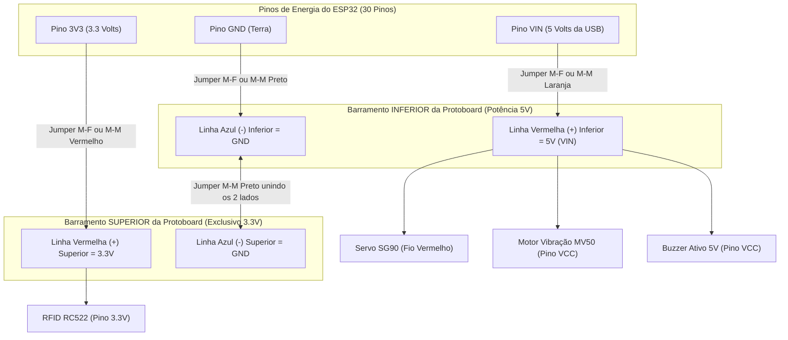

# 🔌 Guia de Montagem Passo a Passo — Protoboard de 400 Pontos + ESP32 (30 Pinos)

Este guia foi elaborado especificamente para os componentes adquiridos pela equipe ([equipamentos.png](../../equipamentos.png)), mostrando **exatamente qual pino ligar em qual pino** utilizando a **Protoboard de 400 pontos** e jumpers **Macho-Fêmea (M-F)** e **Macho-Macho (M-M)**.

---

## 📦 1. Lista de Componentes do Circuito

1. **Microcontrolador:** 1x Placa **ESP32 DOIT DevKit V1 (30 pinos)** com Wi-Fi e Bluetooth.
2. **Sensor de Monitoramento:** 1x Módulo Leitor **RFID NFC RC522** (13.56 MHz, comunicação SPI, **alimentação 3.3V**).
3. **Atuador 1 (Tranca Física):** 1x Micro Servo Motor **SG90 9g** (180 graus, alimentação 5V).
4. **Atuador 2 (Retorno Tátil):** 1x Módulo Motor de Vibração DC PWM **MV50** (alimentação 5V).
5. **Atuador 3 (Retorno Sonoro):** 1x Módulo **Buzzer Ativo 5V**.
6. **Base e Conexões:** 1x **Protoboard de 400 pontos** + Kit de Jumpers (`Macho-Fêmea` e `Macho-Macho`).

---

## ⚠️ 2. Regra de Ouro da Alimentação (`3.3V` vs `5V / VIN`)

> [!CAUTION]
> **ATENÇÃO MÁXIMA ANTES DE LIGAR OS FIOS DE ENERGIA:**
> - O módulo **Leitor RFID RC522** funciona **EXCLUSIVAMENTE em `3.3V`**. Nunca ligue o pino `3.3V` do RC522 no barramento de `5V (VIN)`, pois isso pode queimar o chip do leitor RFID.
> - Já os **3 atuadores** (**Servo SG90**, **Motor de Vibração MV50** e **Buzzer Ativo 5V**) exigem maior corrente e tensão de **`5V`**, devendo ser alimentados pelo pino **`VIN`** do ESP32 (que fornece os 5V vindos do cabo USB).

### Como organizar os barramentos laterais da Protoboard de 400 pontos:

A Protoboard de 400 pontos possui **dois barramentos de energia independentes** (um na borda superior e outro na borda inferior), cada um com uma linha **Vermelha (`+`)** e uma linha **Azul (`-`)**:



#### Passo a passo para preparar a Protoboard (4 Jumpers de Energia):
1. **Importante sobre o encaixe do ESP32:** O ESP32 DOIT DevKit V1 de 30 pinos é largo (ocupa 10 furos de largura). Você tem duas opções práticas na protoboard de 400 pontos:
   - **Opção Recomendada (Mais espaço livre):** Deixe o ESP32 fora da protoboard (sobre a mesa) e use jumpers **Macho-Fêmea (M-F)** saindo direto dos pinos do ESP32 para a Protoboard, OU encaixe apenas uma fileira lateral do ESP32 na protoboard.
2. **Alimentação 3.3V (Barramento Superior):** Ligue o pino **`3V3`** do ESP32 na **Linha Vermelha (`+`) Superior** da protoboard.
3. **Alimentação 5V (Barramento Inferior):** Ligue o pino **`VIN`** do ESP32 na **Linha Vermelha (`+`) Inferior** da protoboard.
4. **Terra Comum (`GND`):**
   - Ligue um pino **`GND`** do ESP32 na **Linha Azul (`-`) Inferior** da protoboard.
   - Use 1 jumper **Macho-Macho (M-M)** preto para conectar a **Linha Azul (`-`) Inferior** à **Linha Azul (`-`) Superior**. Assim, ambos os lados têm o mesmo `GND`!

---

## 📋 3. Tabela Completa de Pinagem (Módulo por Módulo)

### 3.1. Sensor: Módulo Leitor RFID RC522 (Barramento SPI — `3.3V`)

O RC522 utiliza comunicação SPI (VSPI nativo do ESP32). Conecte os **7 pinos utilizados** (o pino `IRQ` fica desconectado) usando jumpers **Macho-Fêmea (M-F)**:

| Pino no RFID RC522 | Pino no ESP32 (30 Pinos) | Serigrafia na Placa ESP32 | Tipo de Jumper | Função |
| :--- | :--- | :--- | :--- | :--- |
| **`SDA` (ou `NSS`/`SS`)** | **GPIO 5** | `D5` | Macho-Fêmea | Chip Select (SS) do barramento SPI |
| **`SCK`** | **GPIO 18** | `D18` | Macho-Fêmea | Clock SPI (VSPI SCK) |
| **`MOSI`** | **GPIO 23** | `D23` | Macho-Fêmea | Dados ESP32 -> RC522 (VSPI MOSI) |
| **`MISO`** | **GPIO 19** | `D19` | Macho-Fêmea | Dados RC522 -> ESP32 (VSPI MISO) |
| **`IRQ`** | *Não conectar* | — | — | Interrupção (não utilizado) |
| **`GND`** | **Barramento `GND`** | `GND` (Linha Azul `-` Superior) | Macho-Fêmea | Terra (0V) |
| **`RST`** | **GPIO 22** | `D22` | Macho-Fêmea | Reset do módulo RFID |
| **`3.3V`** | **Barramento `3.3V`** | `3V3` (Linha Vermelha `+` Superior) | Macho-Fêmea | **Alimentação 3.3V (NÃO LIGAR EM 5V!)** |

---

### 3.2. Atuador 1: Micro Servo Motor SG90 9g (Tranca Física — `5V`)

O cabo do Servo SG90 termina em um conector fêmea de 3 vias. Use **3 jumpers Macho-Macho (M-M)** espetados nesse conector para ligá-lo à protoboard e ao ESP32:

| Fio do Servo SG90 | Pino no ESP32 / Protoboard | Serigrafia no ESP32 | Tipo de Jumper | Função |
| :--- | :--- | :--- | :--- | :--- |
| **Fio Laranja (ou Amarelo)** | **GPIO 13** | `D13` | Macho-Macho | Sinal PWM de posição (`0°` Aberta / `90°` Fechada) |
| **Fio Vermelho** | **Barramento `5V (VIN)`** | Linha Vermelha (`+`) Inferior | Macho-Macho | Alimentação de potência `5V` |
| **Fio Marrom (ou Preto)** | **Barramento `GND`** | Linha Azul (`-`) Inferior | Macho-Macho | Terra comum (`GND`) |

---

### 3.3. Atuador 2: Módulo Motor de Vibração DC PWM MV50 (Retorno Tátil — `5V`)

O módulo MV50 possui 3 pinos (`VCC`, `GND` e `IN` ou `SIG`). Use jumpers **Macho-Fêmea (M-F)**:

| Pino no Módulo MV50 | Pino no ESP32 / Protoboard | Serigrafia no ESP32 | Tipo de Jumper | Função |
| :--- | :--- | :--- | :--- | :--- |
| **`IN` (ou `SIG` / `S`)** | **GPIO 27** | `D27` | Macho-Fêmea | Sinal de acionamento (`600ms` ao fechar / `2x 150ms` ao abrir) |
| **`VCC` (ou `+`)** | **Barramento `5V (VIN)`** | Linha Vermelha (`+`) Inferior | Macho-Fêmea | Alimentação `5V` |
| **`GND` (ou `-`)** | **Barramento `GND`** | Linha Azul (`-`) Inferior | Macho-Fêmea | Terra comum (`GND`) |

---

### 3.4. Atuador 3: Módulo Buzzer Ativo 5V (Retorno Sonoro Local — `5V`)

> [!NOTE]
> Existem dois formatos comuns de Buzzer Ativo 5V:
> - **Módulo de 3 pinos (`VCC`, `GND`, `I/O` ou `S`):** Ligue conforme as 3 linhas abaixo.
> - **Buzzer cilíndrico de 2 pinos (`+` e `-`):** Ligue o pino **`+`** direto no **GPIO 26 (`D26`)** e o pino **`-`** no **Barramento `GND`**.
> - *Dica de Hardware:* Alguns módulos de Buzzer de 3 pinos são *Active-Low* (apitam quando o pino `I/O` recebe `LOW`). O nosso código do ESP32 possui uma constante `BUZZER_ACTIVE_HIGH = true` na linha de configuração; se o seu buzzer ficar apitando direto, basta mudar para `false`!

| Pino no Buzzer Ativo 5V | Pino no ESP32 / Protoboard | Serigrafia no ESP32 | Tipo de Jumper | Função |
| :--- | :--- | :--- | :--- | :--- |
| **`I/O` (ou `S` / Pino `+`)** | **GPIO 26** | `D26` | Macho-Fêmea | Sinal sonoro (`500ms` ao fechar / `2x 150ms` ao abrir) |
| **`VCC` (se 3 pinos)** | **Barramento `5V (VIN)`** | Linha Vermelha (`+`) Inferior | Macho-Fêmea | Alimentação `5V` |
| **`GND` (ou Pino `-`)** | **Barramento `GND`** | Linha Azul (`-`) Inferior | Macho-Fêmea | Terra comum (`GND`) |

---

## 🗺️ 4. Resumo Visual Rápido do ESP32 (30 Pinos)

```text
                   +-----------------------------------+
                   |       ESP32 DOIT DevKit V1        |
                   |            (30 Pinos)             |
                   +-----------------------------------+
  [Barramento 3.3V] <--| 3V3                       VIN |--> [Barramento 5V]
  [Barramento GND]  <--| GND                       GND |--> [Barramento GND]
                       | D15                       D13 |--> [Servo SG90 - Sinal]
                       | D2                        D12 |
                       | D4                        D14 |
                       | RX2                       D27 |--> [Motor Vibração MV50 - IN]
                       | TX2                       D26 |--> [Buzzer Ativo - I/O]
  [RFID RC522 SDA]  <--| D5                        D25 |
  [RFID RC522 SCK]  <--| D18                       D33 |
  [RFID RC522 MISO] <--| D19                       D32 |
                       | D21                       D35 |
                       | RX0                       D34 |
                       | TX0                        VN |
  [RFID RC522 RST]  <--| D22                        VP |
  [RFID RC522 MOSI] <--| D23                        EN |
                   +-----------------------------------+
                            |   [Porta Micro-USB]  |
                            +----------------------+
```

---

## ✅ 5. Checklist de Segurança Antes de Conectar o Cabo USB no Computador

Antes de plugar o cabo USB no ESP32 pela primeira vez, confira estes 5 itens:

- [ ] **1.** O pino **`3.3V` do RFID RC522** está ligado no barramento de **`3.3V`** (pino `3V3` do ESP32) e **não** no `VIN`?
- [ ] **2.** As duas linhas azuis (`-` / `GND`) da protoboard estão interligadas entre si e conectadas ao pino **`GND`** do ESP32?
- [ ] **3.** As linhas vermelhas (`+`) superior (`3.3V`) e inferior (`5V`) estão **separadas** (sem nenhum fio ligando uma na outra)?
- [ ] **4.** Os fios do **Servo SG90** estão na ordem correta (`Marrom = GND`, `Vermelho = 5V`, `Laranja = D13`)?
- [ ] **5.** Os pinos SPI do **RFID RC522** conferem com a tabela (`SDA->D5`, `SCK->D18`, `MOSI->D23`, `MISO->D19`, `RST->D22`)?

Tudo conferido? Agora você já pode conectar o cabo USB e carregar o código [`firmware/esp32_porta_acessivel/esp32_porta_acessivel.ino`](../firmware/esp32_porta_acessivel/esp32_porta_acessivel.ino)!
