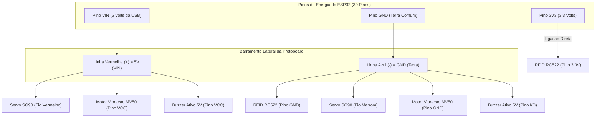

# Guia de Montagem na Protoboard — ESP32 (30 Pinos) + Módulos

Este guia documenta a montagem final validada em bancada na **Protoboard de 400 pontos** com o **ESP32 DOIT DevKit V1 (30 pinos)**, mostrando exatamente qual pino de cada módulo ligar em qual pino do ESP32.

---

## 1. Componentes Utilizados

1. **Microcontrolador:** ESP32 DOIT DevKit V1 (30 pinos) com Wi-Fi integrado.
2. **Sensor de Monitoramento:** Módulo Leitor RFID RC522 (13.56 MHz, comunicação SPI, alimentação `3.3V`).
3. **Atuador 1 (Simulação da Tranca Física):** Micro Servo Motor SG90 9g (`0°` = Porta Aberta / `90°` = Porta Trancada).
4. **Atuador 2 (Retorno Tátil):** Módulo Motor de Vibração DC PWM MV50.
5. **Atuador 3 (Retorno Sonoro):** Módulo Buzzer Ativo 5V (`GND`, `I/O`, `VCC`).
6. **Base e Conexões:** Protoboard de 400 pontos + Jumpers Macho-Fêmea e Macho-Macho.

---

## 2. Organização dos Barramentos de Energia na Protoboard

Para simplificar a montagem e evitar excesso de fios, utilizamos **apenas um lado** das linhas laterais da protoboard para distribuir os **`5V` (`VIN`)** e o **`GND`**, enquanto o **`3.3V`** vai direto do ESP32 para o leitor RFID:



---

## 3. Tabela Completa de Pinagem (Validada em Bancada)

### 3.1. Leitor RFID RC522 (Interface SPI — Alimentação `3.3V`)

> **Atenção:** O pino `3.3V` do RFID RC522 deve ser ligado **exclusivamente** no pino **`3V3`** do ESP32 (nunca em `5V`). O pino `IRQ` não é utilizado.

| Pino no RFID RC522 | Destino no ESP32 / Protoboard | Serigrafia no ESP32 | Função |
| :--- | :--- | :--- | :--- |
| **`SDA` (`SS`)** | **GPIO 5** (Direto no ESP32) | `D5` | Chip Select SPI |
| **`SCK`** | **GPIO 18** (Direto no ESP32) | `D18` | Clock SPI (VSPI SCK) |
| **`MOSI`** | **GPIO 23** (Direto no ESP32) | `D23` | Dados ESP32 -> RC522 |
| **`MISO`** | **GPIO 19** (Direto no ESP32) | `D19` | Dados RC522 -> ESP32 |
| **`IRQ`** | *Não conectar* | — | Não utilizado |
| **`GND`** | **Linha Azul (`-`) da Protoboard** | `GND` | Terra comum (`0V`) |
| **`RST`** | **GPIO 22** (Direto no ESP32) | `D22` | Reset do RC522 |
| **`3.3V`** | **Pino `3V3`** (Direto no ESP32) | `3V3` | Alimentação `3.3V` |

---

### 3.2. Micro Servo Motor SG90 9g (Simulação da Tranca Física — `5V`)

O Servo SG90 simula o mecanismo físico da tranca da porta (`0°` = Porta Aberta/Livre; `90°` = Porta Fechada/Trancada). O firmware aciona o pulso PWM apenas durante os `450ms` do movimento e depois executa `detach()`, garantindo que o servo fique 100% firme sem tremer.

| Fio do Servo SG90 | Destino no ESP32 / Protoboard | Serigrafia no ESP32 | Função |
| :--- | :--- | :--- | :--- |
| **Fio Laranja (ou Amarelo)** | **GPIO 13** (Direto no ESP32) | `D13` | Sinal PWM (`0°` / `90°`) |
| **Fio Vermelho** | **Linha Vermelha (`+`) da Protoboard** | `VIN` (`5V`) | Alimentação `5V` |
| **Fio Marrom (ou Preto)** | **Linha Azul (`-`) da Protoboard** | `GND` | Terra comum (`0V`) |

---

### 3.3. Módulo Motor de Vibração DC PWM MV50 (Retorno Tátil — `5V`)

| Pino no Módulo MV50 | Destino no ESP32 / Protoboard | Serigrafia no ESP32 | Função |
| :--- | :--- | :--- | :--- |
| **`IN` (ou `SIG` / `S`)** | **GPIO 27** (Direto no ESP32) | `D27` | Sinal (`600ms` ao fechar / `2x 150ms` ao abrir) |
| **`VCC`** | **Linha Vermelha (`+`) da Protoboard** | `VIN` (`5V`) | Alimentação `5V` |
| **`GND`** | **Linha Azul (`-`) da Protoboard** | `GND` | Terra comum (`0V`) |

---

### 3.4. Módulo Buzzer Ativo 5V (Retorno Sonoro — Ligação Diferencial `5V / 3.3V`)

Como a cápsula do Buzzer Ativo exige mais de `3.3V` para oscilar e o transistor PNP da plaquinha não corta quando `I/O` recebe os `3.3V` do ESP32 com `VCC` em `5V`, utilizamos a **ligação de chaveamento pelo pino `GND` no `D26`**:

| Pino no Buzzer Ativo 5V | Destino no ESP32 / Protoboard | Serigrafia no ESP32 | Como Funciona |
| :--- | :--- | :--- | :--- |
| **`VCC`** | **Linha Vermelha (`+`) da Protoboard** | `VIN` (`5V`) | Recebe os `5V` da USB |
| **`I/O`** | **Linha Azul (`-`) da Protoboard** | `GND` | Mantém a base polarizada |
| **`GND`** | **GPIO 26** (Direto no ESP32) | `D26` | **`HIGH (3.3V)`** = sobram só `1.7V` (Buzzer 100% mudo)<br>**`LOW (0V)`** = libera os `5.0V` completos (Buzzer apita forte) |

---

## 4. Mapa Rápido de Pinos no ESP32 (30 Pinos)

```text
                   +-----------------------------------+
                   |       ESP32 DOIT DevKit V1        |
                   |            (30 Pinos)             |
                   +-----------------------------------+
  [RFID RC522 3.3V] <--| 3V3                       VIN |--> [Linha Vermelha (+) 5V]
                    ---| GND                       GND |--> [Linha Azul (-) GND]
                       | D15                       D13 |--> [Servo SG90 - Fio Laranja]
                       | D2                        D12 |
                       | D4                        D14 |
                       | RX2                       D27 |--> [Motor Vibracao MV50 - IN]
                       | TX2                       D26 |--> [Buzzer Ativo 5V - Pino GND]
  [RFID RC522 SDA]  <--| D5                        D25 |
  [RFID RC522 SCK]  <--| D18                       D33 |
  [RFID RC522 MISO] <--| D19                       D32 |
                       | D21                       D35 |
                       | RX0                       D34 |
                       | TX0                        VN |
  [RFID RC522 RST]  <--| D22                        VP |
  [RFID RC522 MOSI] <--| D23                        EN |
                   +-----------------------------------+
                            |   [Porta Micro-USB]  |
                            +----------------------+
```
